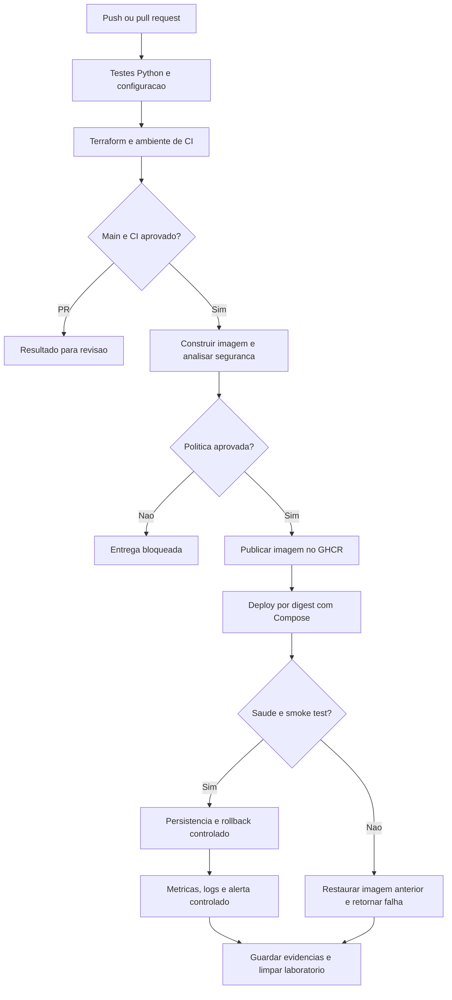

# Fase 2: Entrega Contínua, Monitoramento e Segurança

## Continuidade do projeto

A fase 1 criou uma API de tarefas com persistência em SQLite, 24 testes Python, Dockerfile, Terraform e CI. A execução aprovada ficou registrada em `evidencias-ci.md`. A fase 2 mantém essa base e acrescenta entrega de imagem, orquestração local, observabilidade e verificações de segurança. As instruções anteriores foram preservadas em `fase1-readme.md`.

## Pipeline e configuração

O CI roda a cada push e em pull requests. A publicação e o deploy exigem `main` e sucesso nas verificações anteriores. O job de testes executa agora 36 testes Python, valida o Compose e continua verificando o Terraform, incluindo provisionamento, teste HTTP, convergência e limpeza.

O job seguinte constrói uma imagem com o SHA do commit em `APP_VERSION`. O Trivy verifica segredos nos arquivos, analisa vulnerabilidades da imagem e gera uma SBOM CycloneDX. Segredos detectados e vulnerabilidades HIGH/CRITICAL com correção disponível bloqueiam a entrega. O relatório completo mantém os demais achados para análise.

A mesma imagem aprovada é enviada para `ghcr.io/jonaspc18/projeto_devops_fase1`. A tag identifica o commit e o digest identifica o conteúdo entregue. O último job baixa esse digest e executa `scripts/release_demo.py`, que usa o script de deploy. Não há reconstrução da aplicação entre a análise e a implantação.

As ações do GitHub estão fixadas por SHA. O job de publicação tem `packages: write`; os demais recebem somente as permissões necessárias. O workflow não cancela uma execução em andamento quando chega outro commit, evitando interromper o deploy e sua limpeza. Um `flock` também impede dois deploys simultâneos para o mesmo projeto no host.

## Containers e orquestração

O Dockerfile mantém Python 3.12, a biblioteca padrão e o usuário UID 10001. O Compose reúne três serviços em uma rede bridge: API, Prometheus 3.16.0 e Grafana 13.3.1. Os arquivos de configuração e o dashboard fazem parte do repositório.

| Serviço | Limites e persistência |
| --- | --- |
| API | 0,5 CPU, 128 MB de RAM, 256 MB de RAM + swap e volume SQLite. |
| Prometheus | 0,5 CPU, 256 MB de RAM e volume de métricas, com retenção de 1 dia ou 128 MB. |
| Grafana | 0,5 CPU, 256 MB de RAM, volume próprio e dashboard provisionado. |

Os três serviços usam raiz somente leitura, capabilities removidas, `no-new-privileges` e logs com rotação. A API tem `/tmp` temporário e volume gravável em `/data`. As portas ficam acessíveis somente no host. Compose é uma opção de orquestração em um host, sem os recursos de cluster de Kubernetes ou Swarm.

## Deploy e recuperação

`scripts/deploy.sh` prepara a senha local do Grafana, valida a configuração, obtém a imagem e executa `docker compose up --wait`. Depois, o smoke test verifica a saúde e o ciclo de tarefas. O estado da entrega só muda após essas verificações.

Se a nova imagem falhar, o script tenta restaurar a imagem anterior e repete as verificações. A falha da nova entrega continua retornando código 1, mesmo quando a recuperação funciona. Os volumes não são removidos. `scripts/rollback.sh` permite voltar manualmente à versão anterior após duas entregas aprovadas. Alterações incompatíveis no esquema do banco exigiriam uma estratégia adicional de migração e restauração, que não faz parte deste projeto.

## Monitoramento, logging e segurança

`/metrics` expõe contadores HTTP por método, rota e status, além de um histograma de duração. Os rótulos usam rotas normalizadas, evitando uma série para cada ID de tarefa. O dashboard mostra disponibilidade, volume de requisições, erros 5xx e latência p95. Os contadores reiniciam com o processo; as consultas usam `rate` para tratar reinícios.

O Prometheus coleta a cada 5 segundos e avalia as regras no mesmo intervalo. `ApiIndisponivel` dispara após 15 segundos da condição `up == 0`. `ErrosElevados` acompanha taxa de 5xx acima de 5% por 1 minuto. Os limites foram escolhidos para o laboratório e não representam um SLO validado por carga real. Não foi configurado Alertmanager nem envio de notificações.

Os logs da API são JSON com horário, evento, método, rota, status e duração. Eles omitem corpo e query string. A senha do Grafana é aleatória, montada como secret a partir de um arquivo fora do Git. A API continua sem autenticação e TLS porque o acesso é local e educacional.

## Fluxo completo

## Roteiro da demonstração

1. Implantar a imagem aprovada por digest e conferir o commit em `/version`.
2. Criar uma tarefa de teste, reiniciar a API e conferir que ela permanece no SQLite.
3. Implantar uma imagem defeituosa que não abre o servidor HTTP. Confirmar a rejeição da entrega, a volta à imagem anterior e a preservação da tarefa.
4. Conferir o alvo do Prometheus e o dashboard do Grafana pela API autenticada.
5. Parar a API de forma controlada, observar `ApiIndisponivel` em estado `firing`, reiniciar a aplicação e conferir a resolução do alerta.
6. Repetir o smoke test, validar os logs JSON, salvar os relatórios e remover os recursos temporários.

O ambiente `demonstracao` é efêmero no GitHub Actions. A imagem publicada permanece disponível no registry. A mesma rotina de deploy pode ser usada em um host Docker próprio, mas não foi contratado nem configurado um servidor permanente.

## Resultados e melhorias

Os 36 testes Python passaram na preparação local. A validação remota da entrega será registrada em `docs/evidencias-fase2.md` após a execução. Falhas controladas fazem parte do roteiro e só contam como aprovadas se a recuperação e as verificações posteriores funcionarem.

As próximas melhorias são proteger a branch principal, exigir aprovação para produção, fixar também as imagens de base e monitoramento por digest, automatizar atualizações de dependências, adicionar autenticação/TLS e testar backups. Uma evolução para várias réplicas exigiria rever o banco SQLite e planejar uma infraestrutura de cluster. Também seria útil medir carga, retenção de logs e objetivos de disponibilidade antes de definir recursos de produção.

## Referências técnicas

- GitHub Actions: https://docs.github.com/en/actions/tutorials/publish-packages/publish-docker-images
- Docker Compose: https://docs.docker.com/reference/cli/docker/compose/up/
- Prometheus: https://prometheus.io/docs/prometheus/latest/configuration/alerting_rules/
- Grafana: https://grafana.com/docs/grafana/latest/administration/provisioning/
- Trivy: https://trivy.dev/docs/latest/configuration/filtering/

O relatório segue os temas das aulas indicados no enunciado. Os materiais das aulas 5 a 10 não foram anexados nesta conversa.
